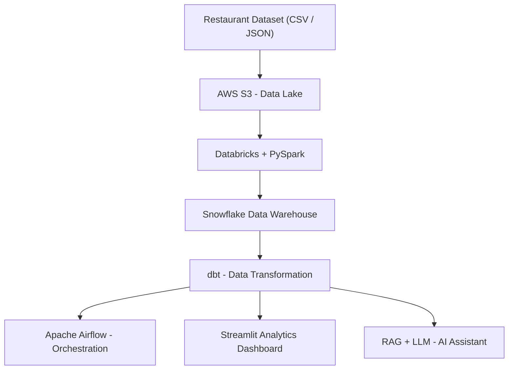

# 🍽️ Zomato AI Data Engineering Platform

**An End-to-End Data Engineering & AI Analytics Project**

Building a scalable data engineering platform to process restaurant data, generate business insights, and enable AI-powered analytics using cloud technologies, distributed computing, modern data warehousing, and Generative AI.

<p align="center">

  
  
  
  
  

</p>

---

## 📌 Project Overview

This project focuses on building an end-to-end data engineering and AI analytics platform around restaurant and food-delivery data.

The objective is to develop a complete data workflow that ingests raw restaurant data, processes and transforms it into structured datasets, stores it in a cloud data warehouse, and makes it accessible for analytical queries and AI-powered business insights.

The platform will combine traditional data engineering practices with modern AI capabilities to demonstrate how raw business data can be transformed into actionable intelligence.

## 🎯 Project Objectives

- Build automated data ingestion workflows using AWS.
- Process and transform large datasets using PySpark.
- Explore distributed data processing with Databricks.
- Design analytical data models in Snowflake.
- Implement modular SQL transformations and data quality testing using dbt.
- Orchestrate end-to-end workflows using Apache Airflow.
- Develop interactive business intelligence dashboards.
- Build an AI-powered assistant for natural-language analytics and restaurant review insights.

## 🏗️ Proposed Architecture



*Architecture is a proposed design and will be updated as implementation progresses.*

## 🛠️ Technology Stack

| Technology | Purpose |
|---|---|
| Python | Data processing and application development |
| PySpark | Large-scale data processing |
| AWS S3 | Cloud-based data lake and storage |
| Databricks | Distributed data engineering |
| Snowflake | Cloud data warehousing |
| dbt | SQL transformations and data modelling |
| Apache Airflow | Workflow orchestration |
| Streamlit | Interactive analytics dashboard |
| RAG & LLMs | AI-powered question answering |

## 📊 Business Use Cases

The platform aims to answer business questions such as:

1. Which cities have the highest concentration of restaurants?
2. Which cuisines receive the highest average ratings?
3. How does restaurant pricing relate to customer ratings?
4. Which restaurants have the highest customer engagement?
5. Does online ordering influence restaurant popularity?
6. What insights can be extracted from customer reviews?

## ⚙️ Planned Implementation

The project is being developed incrementally through the following stages:

- [ ] **Phase 1:** Dataset exploration and business understanding
- [ ] **Phase 2:** AWS S3 data ingestion and storage
- [ ] **Phase 3:** Data cleaning and transformation using PySpark
- [ ] **Phase 4:** Distributed processing using Databricks
- [ ] **Phase 5:** Snowflake data warehouse implementation
- [ ] **Phase 6:** Data modelling and testing using dbt
- [ ] **Phase 7:** Workflow orchestration using Apache Airflow
- [ ] **Phase 8:** Interactive analytics dashboard using Streamlit
- [ ] **Phase 9:** RAG-based AI assistant and Text-to-SQL integration
- [ ] **Phase 10:** Testing, documentation and deployment

## 📁 Project Structure

```text
zomato-ai-data-platform/
│
├── data/
│   ├── raw/
│   └── processed/
│
├── notebooks/
│   ├── data_exploration.ipynb
│   └── pyspark_processing.ipynb
│
├── src/
│   ├── ingestion/
│   ├── processing/
│   └── warehouse/
│
├── databricks/
│
├── snowflake/
│
├── dbt/
│
├── airflow/
│   └── dags/
│
├── ai/
│   ├── rag/
│   └── text_to_sql/
│
├── app/
│
├── tests/
│
├── requirements.txt
├── .gitignore
└── README.md
```

*The structure will evolve as individual components are implemented.*

## 🚀 Expected Outcomes

By completing this project, the goal is to demonstrate practical understanding of:

- End-to-end data engineering architecture.
- ETL/ELT pipelines and data lake concepts.
- Distributed data processing and Spark.
- Cloud data warehousing and SQL analytics.
- Data modelling, testing and orchestration.
- Retrieval-Augmented Generation and LLM integration.
- Building production-oriented data applications.

## 📚 Learning & References

This is an independent learning and implementation project. The work of Darshil Parmar is being used as an educational reference for understanding data engineering concepts and project architecture.

Original learning reference:

[Zomato AI Data Engineering End-to-End Project – Darshil Parmar](https://github.com/darshilparmar/zomato-ai-data-engineering-end-to-end-project)

---

**Project Status:** 🚧 Under Development

**Focus:** Data Engineering | Big Data | Cloud Computing | AI Engineering